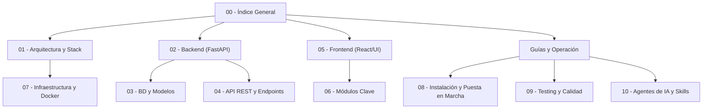

# 🐉 Clon de D&D Beyond (5e 2014) - Documentación General

Bienvenido a la bóveda de documentación en **Obsidian** para el proyecto **Clon de D&D Beyond (Edición 2014)**.

Esta documentación centraliza toda la información técnica, arquitectónica y operativa del monorepo, interconectada mediante enlaces bidireccionales.

---

## 🗺️ Mapa de Contenidos (MOC)

### 📌 Secciones de la Bóveda

1. **[[01 - Arquitectura y Stack]]**: Visión global del monorepo, Clean Architecture, separación estricta de dominios y persistencia híbrida (PostgreSQL + JSONB).
2. **[[02 - Backend - FastAPI y SQLModel]]**: Estructura de capas en `/backend`, ciclo de vida (lifespan), configuración con `pydantic-settings` y middleware CORS.
3. **[[03 - Base de Datos y Modelos]]**: Esquema relacional y JSONB de Personajes, Conjuros, Clases, Razas, Monstruos, Equipo y Homebrew. Migraciones con Alembic.
4. **[[04 - API REST y Endpoints]]**: Catálogo de rutas HTTP (`/api/characters`, `/api/spells`, `/api/classes`, `/api/manuals`, `/api/seed`, etc.) y contratos de datos.
5. **[[05 - Frontend - React y UI]]**: Stack de cliente (React 19, Vite, TypeScript, Tailwind CSS, shadcn/ui, TanStack Query) y enrutamiento con React Router v7.
6. **[[06 - Módulos Clave del Sistema]]**:
   - Hoja de personaje interactiva y sistema de Level Up en tiempo real.
   - Tirador de dados con animación 3D y registro histórico.
   - Compendio SRD 5e e importador automático 5etools.
   - Visor de manuales PDF locales integrado en la web.
7. **[[07 - Infraestructura y Docker]]**: Orquestación con `docker-compose.yml` para PostgreSQL 15 y pgAdmin 4.
8. **[[08 - Guía de Instalación y Puesta en Marcha]]**: Comandos de consola paso a paso para desplegar base de datos, backend y frontend en Windows PowerShell.
9. **[[09 - Testing y Calidad de Código]]**: Pruebas automatizadas con `pytest` en base de datos aislada (`_test`), linter y compilación estática.
10. **[[10 - Agentes de IA y Skills]]**: Arquitectura de agentes de soporte (`backend-expert`, `frontend-expert`, `srd-extractor`) y reglas de desarrollo.

---

> [!TIP] Navegación en Obsidian
> Presiona `Ctrl + O` para buscar cualquier nota por nombre, o activa la **Vista de Grafo** (`Ctrl + G`) para explorar visualmente cómo se relacionan los conceptos del proyecto.

