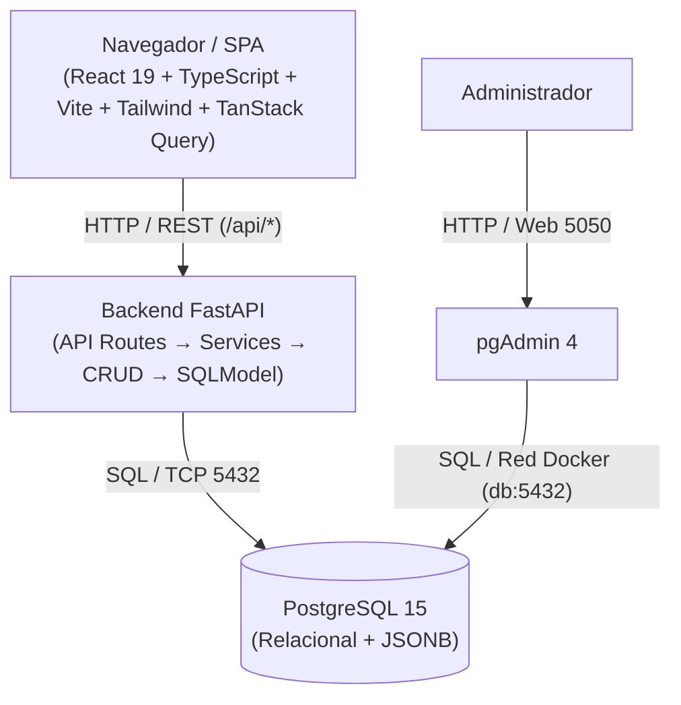

# 🏛️ 01 - Arquitectura y Stack Tecnológico

#arquitectura #stack #clean-architecture #monorepo

El proyecto es un **Monorepo Full-Stack** diseñado para la gestión integral de hojas de personaje, consulta de reglas y compendios basados en las reglas oficiales de **Dungeons & Dragons 5ª Edición (SRD 2014)**.

---

## 1. Diagrama de Arquitectura Global

---

## 2. Invariantes del Workspace (Reglas de Oro)

1. **Aislamiento Estricto de Dominios:**
   - La lógica del backend reside exclusivamente en `/backend`.
   - La lógica del cliente reside en `/frontend`.
   - Ningún código del cliente importa módulos de Python ni accede a variables del backend directamente.

2. **Persistencia Híbrida (Relacional + JSONB):**
   - Las entidades principales usan columnas relacionales con tipado estricto (`id`, `name`, `level`, `hit_points`, `armor_class`, etc.).
   - Estructuras heterogéneas, listas variables o propiedades complejas (como rasgos de clase, habilidades, slots de conjuros, entradas de equipo) se almacenan en columnas de tipo `JSONB` de PostgreSQL soportadas por `SQLModel`.

3. **Componentes UI Reutilizables:**
   - Adherencia a los componentes de **shadcn/ui** y Radix UI antes de inventar componentes visuales desde cero.

4. **Seguridad y Aislamiento de Credenciales:**
   - Cero credenciales o cadenas de conexión en el código fuente.
   - Todo se inyecta desde variables de entorno gestionadas en `.env` y centralizadas en [[02 - Backend - FastAPI y SQLModel#Configuración y Variables|core/config.py]].

---

## 3. Enlaces Relacionados

- [[02 - Backend - FastAPI y SQLModel]]
- [[03 - Base de Datos y Modelos]]
- [[05 - Frontend - React y UI]]
- [[07 - Infraestructura y Docker]]
- Volver al [[00 - Índice General]]

