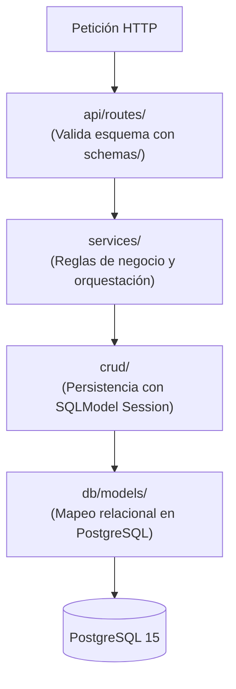

# ⚙️ 02 - Backend - FastAPI y SQLModel

#backend #fastapi #python #sqlmodel #clean-architecture

El backend está construido con **FastAPI** y **SQLModel** (que unifica SQLAlchemy 2.0 y Pydantic V2), aplicando los principios de Clean Architecture.

---

## 1. Estructura de Directorios

```
backend/
├── app/
│   ├── __init__.py
│   ├── main.py              # Punto de entrada de FastAPI y configuración de ciclo de vida
│   ├── api/                 # Controladores HTTP y dependencias
│   │   ├── dependencies.py  # Inyección de dependencias (SessionDep)
│   │   └── routes/          # Routers individuales por recurso
│   │       ├── characters.py
│   │       ├── spells.py
│   │       ├── classes.py
│   │       ├── races.py
│   │       ├── monsters.py
│   │       ├── equipment.py
│   │       ├── manuals.py
│   │       ├── seed.py
│   │       └── homebrew.py
│   ├── core/                # Configuración global y seguridad
│   │   ├── config.py        # Settings mediante pydantic-settings (.env)
│   │   └── security.py      # Lógica de seguridad y hash
│   ├── db/                  # Conexión a la base de datos y modelos
│   │   ├── database.py      # Engine de SQLAlchemy y creación de tablas
│   │   ├── seed.py          # Datos semilla iniciales del compendio
│   │   └── models/          # Entidades SQLModel (tablas)
│   ├── schemas/             # Modelos Pydantic para validación de entrada/salida
│   ├── crud/                # Operaciones de persistencia desacopladas
│   └── services/            # Lógica de negocio y orquestación
├── migrations/              # Control de versiones de base de datos con Alembic
├── scripts/                 # Utilidades de mantenimiento (ej: importador SRD)
├── tests/                   # Pruebas automatizadas con pytest
└── requirements.txt         # Dependencias del backend
```

---

## 2. Flujo de Capas (Clean Architecture)



---

## 3. Configuración y Variables de Entorno

La configuración se administra en `backend/app/core/config.py` mediante `Settings(BaseSettings)`:
- `DATABASE_URL`: Cadena de conexión principal (PostgreSQL).
- `TEST_DATABASE_URL`: Cadena de conexión para la base de pruebas aislada (`dnd_beyond_clone_test`).
- `PROJECT_NAME`: Nombre del servicio.
- `BACKEND_CORS_ORIGINS`: Lista de orígenes autorizados para el frontend (ej. `http://localhost:5173`).

---

## 4. Ciclo de Vida (Lifespan)

En `backend/app/main.py`:
- Durante el arranque (`lifespan`), se llama automáticamente a `create_db_and_tables()` para asegurar que todas las tablas existan en PostgreSQL antes de atender tráfico.
- Se configuran los middleware de **CORS** para habilitar la comunicación fluida con la SPA de Vite.

---

## 5. Enlaces Relacionados

- [[03 - Base de Datos y Modelos]]
- [[04 - API REST y Endpoints]]
- [[07 - Infraestructura y Docker]]
- [[09 - Testing y Calidad de Código]]
- Volver al [[00 - Índice General]]

