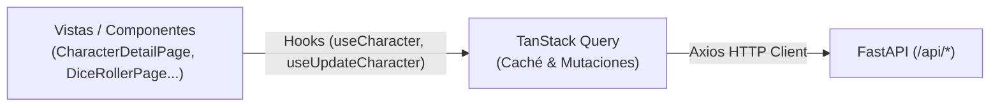

# 💻 05 - Frontend - React y UI

#frontend #react #typescript #vite #tailwind #shadcn #tanstack-query

La aplicación de interfaz de usuario es una SPA (Single Page Application) moderna diseñada con foco en la estética fantasía oscura clásica de D&D Beyond.

---

## 1. Stack Tecnológico

- **Framework & Build:** React 19 + TypeScript impulsado por **Vite 8**.
- **Enrutamiento:** React Router DOM v7 con layouts anidados.
- **Estilos:** Tailwind CSS con la paleta vintage compendio D&D de `Proyecto`:
  - Fondo pergamino/papel (`#f3efe4` / `--wiki-paper`)
  - Superficies y cartas (`#fffdf8` / `--wiki-surface`)
  - Tinta oscura de lectura (`#26342e` / `--wiki-ink`)
  - Verde bosque profundo (`#19352b` / `--wiki-forest`)
  - Cobre de acento (`#bd7446` / `--wiki-copper`)
  - Oro envejecido (`#d9b66d` / `--wiki-gold`)
  - Líneas y bordes (`#e7e0d1` / `--wiki-line`)
- **Componentes Base:** Primitivas de accesibilidad de **Radix UI** estilizadas bajo la filosofía **shadcn/ui** (Dialog, Accordion, Sheet, Select, Tabs, Button, Card, Table).
- **Gestión de Estado de Servidor:** **TanStack Query (React Query) v5** para caché automática, revalidación en segundo plano y mutaciones optimistas.

---

## 2. Estructura de Carpetas

```
frontend/src/
├── api/                     # Hooks de TanStack Query y clientes HTTP (Axios)
│   ├── client.ts            # Instancia configurada de Axios (VITE_API_BASE_URL)
│   └── useCharacters.ts     # Hooks: useCharacters, useCharacter, useUpdateCharacter...
├── components/
│   ├── common/              # Componentes compartidos (QueryError, StatBlock...)
│   ├── layout/              # Estructura visual de página (Navbar, Layout, Footer)
│   └── ui/                  # Componentes atómicos shadcn/ui
├── features/                # Módulos organizados por dominio funcional
│   ├── home/                # Página de inicio con accesos directos
│   ├── characters/          # Listado, creador asistido y hoja interactiva
│   ├── compendium/          # Explorador de conjuros, razas, clases, monstruos y equipo
│   ├── dice/                # Lanzador de dados interactivo con animación 3D
│   ├── books/               # Lector web de manuales PDF locales
│   └── homebrew/            # Gestión de contenido casero
├── App.tsx                  # Definición de rutas principales
└── index.css                # Estilos globales, animaciones y glassmorphism
```

---

## 3. Manejo de Estado y Flujo de Peticiones



Todas las llamadas al backend se orquestan mediante **TanStack Query**:
- Cuando se actualiza un personaje (por ejemplo, al pulsar **Level Up**), la mutación actualiza el servidor mediante `PUT /api/characters/{id}` y ejecuta `refetch()` o invalidación de query, actualizando de inmediato estadísticas derivadas como bonificador de competencia, puntos de golpe o slots.
- Los errores de red se capturan elegantemente con el componente `QueryError`, que ofrece un botón de reintento interactivo.

---

## 4. Enlaces Relacionados

- [[01 - Arquitectura y Stack]]
- [[04 - API REST y Endpoints]]
- [[06 - Módulos Clave del Sistema]]
- Volver al [[00 - Índice General]]

